# Lagrange Multipliers and Ridge Regression: Complete Notes

2026-11-14

> Interactive 3D version: open `interactive.html` (or enable GitHub Pages for this repo). A typeset PDF is in `Lagrange_and_Ridge_Complete_Notes.pdf`.

## Part I: Lagrange multipliers

Part I builds the method from contours and gradients, extends it to inequality constraints, and connects it to ridge. Part II (Sections 14–22) proves the ridge equivalence in full. Section 23 summarizes both.

## 1. The problem

Lagrange multipliers find the maximum or minimum of a function f when the inputs must satisfy a constraint g(x, y) = c.

```math
\text{maximize or minimize } f(x, y) \quad \text{subject to} \quad g(x, y) = c
```

| Symbol  | Meaning                                                  | Example                      |
|---------|----------------------------------------------------------|------------------------------|
| f(x, y) | the function to optimize                                 | 2x + y                       |
| g(x, y) | the constraint function                                  | x² + y²                      |
| c       | a fixed constant given by the problem                    | 1                            |
| g = c   | shorthand for g(x, y) = c: the curve you must stay on    | x² + y² = 1, the unit circle |
| k       | a trial value of f; f(x, y) = k is one contour line of f | 2x + y = k                   |
| λ       | the Lagrange multiplier, a new unknown you introduce     | found by solving             |

The constraint curve g = c is itself one contour line of g. The method compares the contour lines of f with this one contour of g.

In 3D, the graph of f is a surface and the constraint circle is lifted onto it. The answers are the highest and lowest points of the lifted curve.

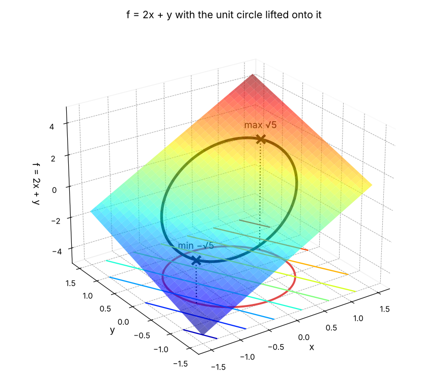

## 2. The contour picture: miss, cross, tangent

The maximum and minimum of f on the constraint occur where a contour line of f is tangent to the curve g = c. Slide the contour f = k by changing k and watch how it meets the circle (example f = 2x + y on x² + y² = 1):

| Contour 2x + y = k | Meets the circle at | Meaning                                                      |
|--------------------|---------------------|--------------------------------------------------------------|
| k = 2.5            | no points (misses)  | no point on the circle has f = 2.5; the value is unreachable |
| k = 1              | 2 points (crosses)  | reachable, but not the max or min                            |
| k = √5 ≈ 2.24      | 1 point (tangent)   | the maximum                                                  |
| k = −√5            | 1 point (tangent)   | the minimum                                                  |

**Concept check (Khan Academy).** If the line f = k does not meet the circle, it means there are no x and y satisfying both 2x + y = k and x² + y² = 1. It does not mean the optimization problem has no solution.

### Why a crossing point is never an extreme

A contour line splits the plane into a side where f \> k and a side where f \< k. If it crosses the circle, the circle has points on both sides, so f takes values both above and below k on the circle.

Example with k = 1. The line 2x + y = 1 crosses the circle at (0, 1) and (0.8, −0.6). But (1, 0) is also on the circle and gives f = 2 \> 1, and (−1, 0) gives f = −2 \< 1. So f = 1 is neither the max nor the min.

Moving along the circle from a crossing point, one direction increases f and the other decreases it. The rate of change is ∇f · T, where T is the direction of travel along the circle. At (0, 1), counterclockwise T = (−1, 0) gives ∇f · T = −2 (f falls), and clockwise gives +2 (f rises).

### Sliding to the tangent line

As k grows, the two crossing points move together. At k = √5 they merge into one: the line is tangent, no part of the circle is left on the bigger side, and k is the maximum. Tangent means one meeting point with no circle beyond it; crossing means two meeting points with circle left over.

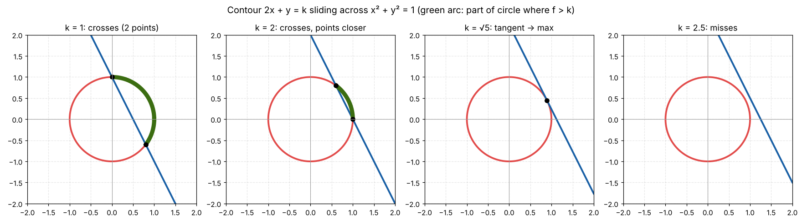

### Why only two tangents count

A circle has a tangent line at every point, but all contour lines of one function f are parallel (for 2x + y, all have slope −2). Only two lines of that direction can be tangent to the circle: one gives the max, one the min. A tangent at another angle, such as y = 1 at (0, 1), is not a contour of 2x + y (f changes along it), so it says nothing about the max of 2x + y.

## 3. From tangency to gradients

Tangent contour lines have parallel gradients, which turns the picture into an equation. Two facts make this work:

1.  ∇f is always perpendicular to the contour line of f through that point (it points toward fastest increase).

2.  ∇g is perpendicular to the curve g = c, because that curve is a contour of g.

At a crossing point the two contours point in different directions, so the gradients do too. At a tangent point the contours point the same way, so the gradients are parallel. Parallel vectors differ only by a scalar factor:

```math
\nabla f(x_0, y_0) = \lambda_0 \, \nabla g(x_0, y_0)
```

The tangency tells us nothing about the lengths of the two gradients, so λ₀ is an unknown scalar to be solved for. Equivalently, the rate of change along the curve, ∇f · T, is zero exactly when ∇f is perpendicular to the direction of travel, that is, parallel to ∇g.

For f = 2x + y and g = x² + y²:

```math
\nabla f = \begin{bmatrix} 2 \\ 1 \end{bmatrix}, \qquad \nabla g = \begin{bmatrix} 2x \\ 2y \end{bmatrix}, \qquad \begin{bmatrix} 2 \\ 1 \end{bmatrix} = \lambda \begin{bmatrix} 2x \\ 2y \end{bmatrix}
```

## 4. The full system: two conditions together

∇f = λ∇g alone cannot be solved; it needs the constraint g = c as well. You always write λ as an unknown, never a number such as 2: the value of λ comes out of the solution.

```math
\nabla f = \lambda \nabla g \qquad \text{and} \qquad g(x, y) = c
```

**Counting.** The unknowns are x, y and λ (3). ∇f = λ∇g gives 2 equations; g = c gives the third. Three equations in three unknowns can be solved.

**Why ∇f = λ∇g contains no c.** c is a constant, and its derivative is zero, so ∇g is the same for every c (for g = x² + y², ∇g = (2x, 2y) whether c is 1, 5 or 100). c appears only in g = c.

**What each part does.** For f = x + y, ∇f = λ∇g gives only x = y: a whole line of possible tangent points, one for every circle. g = c picks one circle and so pins down the actual points.

| Circle      | Tangent point on y = x | Max of x + y |
|-------------|------------------------|--------------|
| x² + y² = 1 | (0.71, 0.71)           | √2 ≈ 1.41    |
| x² + y² = 5 | (1.58, 1.58)           | √10 ≈ 3.16   |
| x² + y² = 9 | (2.12, 2.12)           | 3√2 ≈ 4.24   |

- **∇f = λ∇g** (no c): where tangency can happen.

- **g = c** (has c): which curve you must stay on.

## 5. The Lagrangian

The Lagrangian is not new mathematics: it packs ∇f = λ∇g and g = c into one function, so that setting its gradient to zero gives all three equations at once. You can always solve the two conditions directly instead.

```math
\mathcal L(x, y, \lambda) = f(x, y) - \lambda\big(g(x, y) - c\big)
```

### How c gets in

c comes from the problem, λ is introduced by you. Write the constraint with zero on one side, then subtract λ times that side from f:

1.  Constraint: x² + y² = 5.

2.  Move c across: x² + y² − 5 = 0.

3.  Build 𝓛 = f − λ(x² + y² − 5).

Rule: write the constraint as “something = 0”, then 𝓛 = f − λ × (something). On the constraint that something is 0, so 𝓛 = f at the points you care about.

### Why −λ(g − c) and not just −λg

With 𝓛₀ = f − λg, the x and y derivatives already give ∇f = λ∇g, but ∂𝓛₀/∂λ = −g, which sets g = 0, the wrong constraint. Adding a term h(λ) with no x or y leaves the x and y equations alone and makes the λ derivative −g + h′(λ). Matching −g + c forces h(λ) = λc, giving f − λ(g − c).

### What each derivative gives

Multiply out: 𝓛 = f − λg + λc. The term λc has no x or y, so it vanishes in the x and y derivatives and survives only in the λ derivative.

| Derivative set to 0 | Result                 | Has c? | Part of        |
|---------------------|------------------------|--------|----------------|
| ∂𝓛/∂x               | fₓ = λ gₓ              | no     | ∇f = λ∇g       |
| ∂𝓛/∂y               | fᵧ = λ gᵧ              | no     | ∇f = λ∇g       |
| ∂𝓛/∂λ               | −(g − c) = 0, so g = c | yes    | the constraint |

```math
\nabla \mathcal L = 0 \quad\Longleftrightarrow\quad \nabla f = \lambda \nabla g \;\text{ and }\; g = c
```

∇f = λ∇g is only the x and y part of ∇𝓛 = 0, not all of it. ∂𝓛/∂λ is not c itself: it is −(g − c), an expression in x and y, and setting it to zero returns the constraint.

**Example.** For f = 2x + y on the unit circle:

```math
\nabla \mathcal L = \begin{bmatrix} 2 - 2\lambda x \\ 1 - 2\lambda y \\ -x^2 - y^2 + 1 \end{bmatrix} = \begin{bmatrix} 0 \\ 0 \\ 0 \end{bmatrix}
```

**Sign convention.** Some books write 𝓛 = f **+** λ(g − c). The points found are identical; only the sign of λ flips. Ridge regression uses the + form so that λ ≥ 0 reads as a penalty.

## 6. Worked examples

All five use the method above; the last two show what changes when f is curved or has a restricted domain.

### 6.1 Simplest case: f = y on x² + y² = 1

Contours of f are horizontal lines y = k. The tangent ones are y = 1 and y = −1.

- ∇f = (0, 1), ∇g = (2x, 2y), so 0 = 2λx and 1 = 2λy.

- The second gives λ ≠ 0, so x = 0; the constraint gives y = ±1.

- Max 1 at (0, 1), min −1 at (0, −1): the top and bottom of the circle.

The vertical line x = 1 is also tangent to the circle, but it is not a contour of y, so (1, 0) is not an extreme of f = y. For f = x it would be.

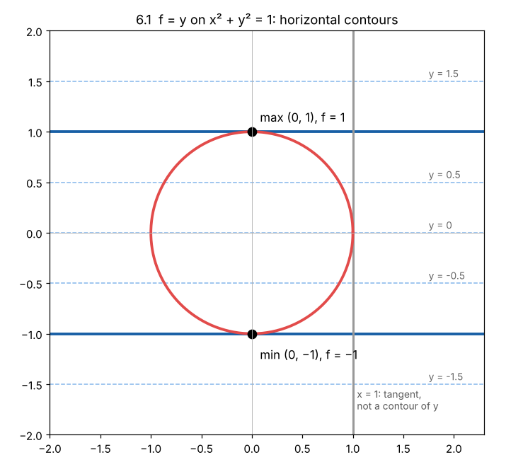

### 6.2 Khan Academy’s example: f = 2x + y on x² + y² = 1

2 = 2λx and 1 = 2λy give x = 1/λ and y = 1/(2λ), so x = 2y. Then 5y² = 1.

| Point                       | f         | Type    |
|-----------------------------|-----------|---------|
| (2/√5, 1/√5) ≈ (0.89, 0.45) | √5 ≈ 2.24 | maximum |
| (−2/√5, −1/√5)              | −√5       | minimum |

For a linear f on a circle, the max lies in the direction of ∇f and the min opposite it.

The 3D view of this example is in Section 1, and its gradients at the max and min are drawn in Section 9.

### 6.3 Changing c: f = x + y on x² + y² = 5

𝓛 = x + y − λ(x² + y² − 5). The x and y equations give x = y; only the λ equation contains the 5. Then 2x² = 5, so x = ±√2.5 ≈ ±1.58.

|           | c = 1        | c = 5        |
|-----------|--------------|--------------|
| Max point | (0.71, 0.71) | (1.58, 1.58) |
| Max of f  | √2 ≈ 1.41    | √10 ≈ 3.16   |
| λ at max  | ≈ 0.71       | ≈ 0.32       |

The same problem solved directly, without 𝓛: (1, 1) = λ(2x, 2y) gives x = y (λ = 0 is impossible since 1 ≠ 0), and x² + y² = 5 gives the same two points.

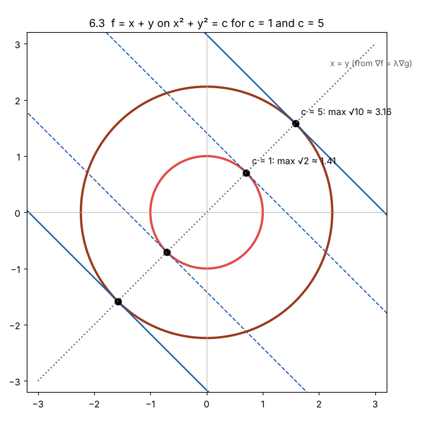

### 6.4 Curved contours: f = 2x² + √5·y on x² + y² = 1

Contours are downward parabolas y = (k − 2x²)/√5. The x equation 4x = λ·2x gives x = 0 or λ = 2.

| Point                          | λ     | f            | Type                            |
|--------------------------------|-------|--------------|---------------------------------|
| (±√11/4, √5/4) ≈ (±0.83, 0.56) | 2     | 21/8 = 2.625 | maximum (tangent at two points) |
| (0, 1)                         | √5/2  | √5 ≈ 2.236   | local minimum                   |
| (0, −1)                        | −√5/2 | −√5          | minimum                         |

At the max, ∇f = 2∇g exactly: the gradients are parallel and ∇f is twice as long. Each critical point has its own λ, so you never write ∇f = 2∇g in advance. Tangency gives candidates; comparing f values classifies them (here (0, 1) is tangent but only a local min).

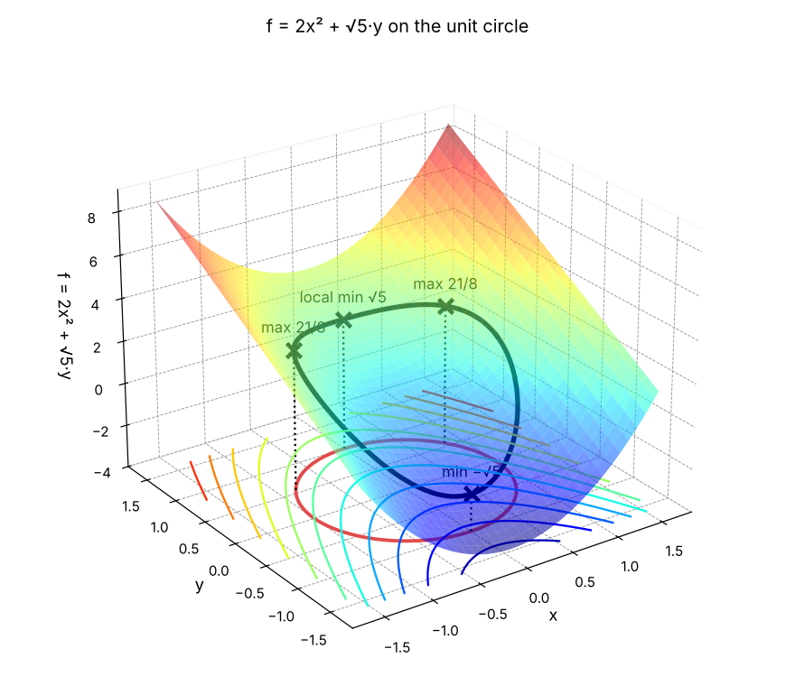

### 6.5 The √(5y) version and the plotting bug

Khan Academy’s article writes the second example as f = 2x² + √(5y), defined only for y ≥ 0. Its interactive contour plot shows a W shape because it draws y = (k − 2x²)²/5: squaring adds outer arms where √(5y) would have to be negative. Only the middle hump (\|x\| ≤ √(k/2)) is the real contour; Khan’s comment section reports the same bug.

For this version only the upper half circle is allowed:

| Point           | f       | Type          | Found by                         |
|-----------------|---------|---------------|----------------------------------|
| (±0.904, 0.428) | ≈ 3.097 | maximum       | tangency, λ = 2 (y^(3/2) = √5/8) |
| (0, 1)          | √5      | local minimum | tangency, x = 0                  |
| (±1, 0)         | 2       | minimum       | edge of the domain               |

The minimum sits at the end of the allowed half circle, where the slope in y is infinite. It is not a tangency, so ∇f = λ∇g misses it: always check boundary points as well.

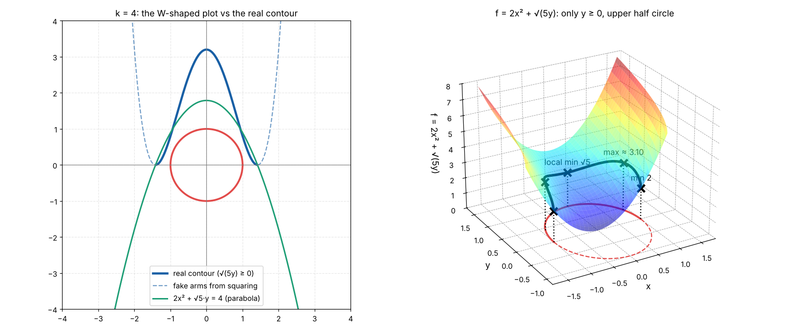

## 7. Connection to ridge regression

Ridge regression is the same method with f = RSS, g = ‖β‖² and an inequality constraint.

```math
\min_\beta \; (\mathbf y - \mathbf X\beta)^T(\mathbf y - \mathbf X\beta) \quad \text{subject to} \quad \sum_{j=1}^p \beta_j^2 \le t
```

|                | Lagrange example            | Ridge                                 |
|----------------|-----------------------------|---------------------------------------|
| f (optimized)  | 2x + y                      | RSS = (y − Xβ)ᵀ(y − Xβ)               |
| g (constraint) | x² + y²                     | βᵀβ = Σβⱼ²                            |
| c              | 1                           | t (the budget)                        |
| Variables      | x, y                        | β₁, …, βₚ                             |
| ∇f             | (2, 1)                      | −2Xᵀ(y − Xβ)                          |
| ∇g             | (2x, 2y)                    | 2β                                    |
| Contours of f  | parallel lines              | ellipses centred at OLS               |
| Tangency       | contour line touches circle | smallest RSS ellipse touches the disk |
| λ              | Lagrange multiplier         | regularization parameter              |

**The derivation.** With 𝓛 = RSS + λ(βᵀβ − t), differentiating with respect to β gives

```math
\underbrace{-2\mathbf X^T(\mathbf y - \mathbf X\beta)}_{\nabla f} + \lambda\underbrace{(2\beta)}_{\nabla g} = 0 \;\Longrightarrow\; (\mathbf X^T\mathbf X + \lambda I)\beta = \mathbf X^T\mathbf y \;\Longrightarrow\; \hat\beta_{\text{ridge}} = (\mathbf X^T\mathbf X + \lambda I)^{-1}\mathbf X^T\mathbf y
```

This is the tangency condition again, written as ∇f = −λ∇g because ridge uses the + sign convention.

**The difference: ≤ instead of =.** Any β inside the disk is allowed, so instead of setting ∂𝓛/∂λ = 0 you use complementary slackness:

```math
\lambda\,(\beta^T\beta - t) = 0, \qquad \lambda \ge 0
```

- OLS inside the disk: the constraint is slack, λ = 0, and ridge equals OLS (like the minima in Wikipedia’s Example 2, where ∇f = 0).

- OLS outside the disk: the constraint is tight, λ \> 0, the solution is on the edge βᵀβ = t, and tangency applies.

**λ as a price.** λ measures how much the best attainable value changes if the constraint is relaxed: λ = −dRSS\*/dt for ridge. In 6.4, λ = 2 at the max means enlarging the circle to x² + y² = 1 + ε raises the max by about 2ε. In practice the ridge λ is chosen by cross-validation.

Full details, proofs and 3D figures are in Part II (Sections 14–22).

## 8. Inequality constraints (KKT)

With g ≤ c the solution may lie inside the region, so the λ equation changes: instead of ∂𝓛/∂λ = 0 you use the Karush–Kuhn–Tucker (KKT) conditions. The x, y (or β) equations stay the same.

|                            | Equality g = c               | Inequality g ≤ c                     |
|----------------------------|------------------------------|--------------------------------------|
| Where the answer can be    | only on the constraint curve | inside the region or on its boundary |
| x, y (or β) equations      | ∇f = λ∇g                     | ∇f = λ∇g (same)                      |
| λ equation                 | ∂𝓛/∂λ = 0, so g = c          | g ≤ c, λ ≥ 0, λ(g − c) = 0           |
| Sign of λ                  | any                          | restricted (see Section 9)           |
| Parallel gradients enough? | yes                          | no, the direction must be right too  |

Complementary slackness, λ(g − c) = 0, covers both cases in one equation: either λ = 0 (answer inside, constraint slack) or g = c (answer on the boundary, constraint active).

**Recipe for ≤ constraints.**

1.  Find the unconstrained optimum (for ridge, OLS).

2.  If it satisfies g ≤ c, it is the answer, with λ = 0.

3.  Otherwise the answer is on the boundary: solve the equality problem g = c and check the sign of λ.

**Why you cannot just set ∂𝓛/∂λ = 0.** Take RSS = (β − 3)² (OLS = 3) with β² ≤ t and 𝓛 = RSS + λ(β² − t). Forcing β² = t:

| t   | Points with β² = t | λ from 2(β − 3) + 2λβ = 0 | Correct answer               |
|-----|--------------------|---------------------------|------------------------------|
| 4   | β = 2 / β = −2     | 0.5 ✓ / −2.5 ✗            | β = 2, λ = 0.5 (OLS outside) |
| 16  | β = 4 / β = −4     | −0.25 ✗ / −1.75 ✗         | β = 3, λ = 0 (OLS inside)    |

With t = 16 every boundary candidate has λ \< 0, which signals that the true answer is inside: β = 3, where ∂𝓛/∂λ = 9 − 16 \< 0 is allowed.

**In short.** For an equality the answer is always a tangent point on the constraint curve. For an inequality it is either the unconstrained optimum inside the region (λ = 0) or a tangent point on the boundary (λ \> 0).

## 9. The sign of λ

The sign of λ tells you which side of the constraint curve f is bigger on. Two facts give this:

- ∇f points the way f gets bigger.

- ∇g points outward, because g = x² + y² gets bigger as you move away from the centre.

So, since multiplying a vector by a positive number keeps its direction and by a negative number flips it:

| λ      | ∇f = λ∇g means                         | f is bigger            |
|--------|----------------------------------------|------------------------|
| λ \> 0 | ∇f points the same way as ∇g (outward) | outside                |
| λ \< 0 | ∇f points the opposite way (inward)    | inside                 |
| λ = 0  | ∇f = 0                                 | f is flat at the point |

The sign of λ always equals the sign of ∇f · ∇g.

### Concrete case: f = 2x + y on x² + y² = 1

∇f = (2, 1) is the same arrow everywhere; ∇g = (2x, 2y) always points out of the circle; λ = 1/x.

| Point              | ∇g             | λ     | ∇f vs ∇g | Step inside           |
|--------------------|----------------|-------|----------|-----------------------|
| max (0.89, 0.45)   | (1.79, 0.89)   | +1.12 | same     | f drops 2.24 → 1.75   |
| min (−0.89, −0.45) | (−1.79, −0.89) | −1.12 | opposite | f rises −2.24 → −1.75 |

These are the only two boundary points that have a λ at all; elsewhere on the circle the gradients are not parallel.

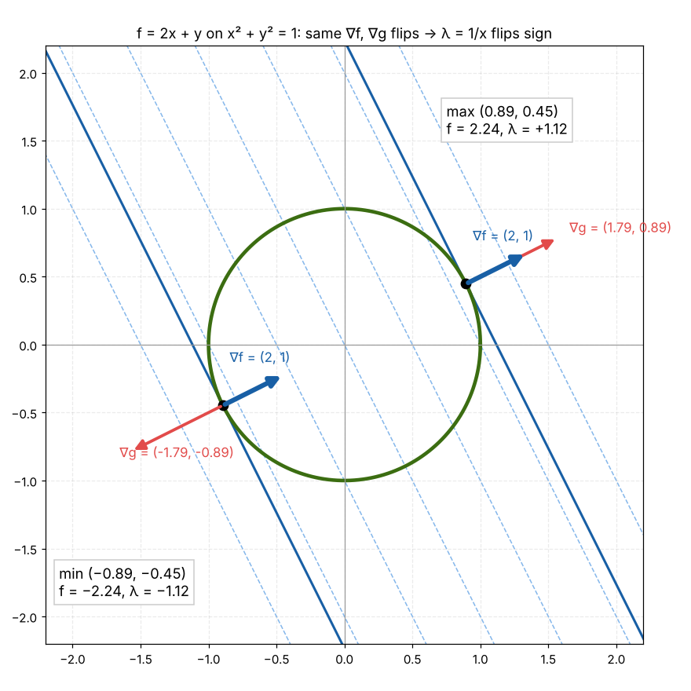

### Equality versus inequality

- **Equality:** you can only move along the curve, so neither side is reachable. Both signs of λ are valid: the max (λ \> 0) and the min (λ \< 0) are both answers.

- **Inequality, maximizing f:** you may step inside. If λ \< 0, f is bigger inside and inside is allowed, so you step in: the point is rejected. If λ \> 0, f is bigger outside, which is not allowed: the boundary blocks you and the point is the answer.

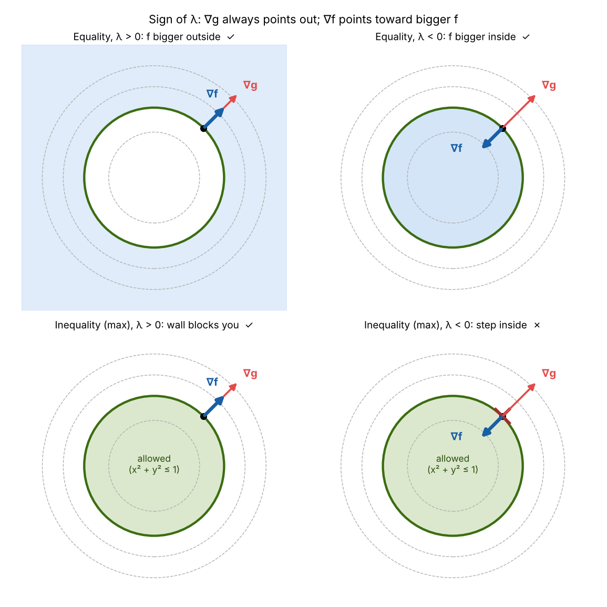

From a rejected λ \< 0 point, you would keep moving uphill (along ∇f) until you reach either the peak of f inside the region (λ = 0) or the boundary point where ∇f points straight outward (λ \> 0). For f = 2x + y there is no interior peak, so you end at (0.89, 0.45). λ does not grow gradually along the way: it is only defined at the candidate points.

### The rule depends on max/min and on the sign convention

| Goal and form                                | Valid boundary answer needs |
|----------------------------------------------|-----------------------------|
| maximize f, ∇f = λ∇g                         | λ ≥ 0 (∇f points out)       |
| minimize f, ∇f = λ∇g                         | λ ≤ 0 (∇f points in)        |
| minimize f, ∇f = −λ∇g (ridge’s + convention) | λ ≥ 0                       |

So the negative λ at the min of 2x + y is exactly what a minimum looks like in the ∇f = λ∇g form, and ridge’s sign convention is chosen so its λ comes out positive.

### Walking to the optimum: maximum and minimum

A rejected boundary point tells you which way to move. For a **maximum**, from a boundary point with λ \< 0 (f bigger inside), step inside and keep moving uphill along ∇f until you reach either the peak of f inside (λ = 0) or the boundary point where ∇f points straight outward (λ \> 0).

For a **minimum** everything mirrors:

1.  At a boundary point with λ \> 0, ∇f points outward, so f is smaller inside: step inside.

2.  Keep moving downhill, along −∇f.

3.  Stop at the lowest point of f inside (∇f = 0, λ = 0) or at the boundary point where ∇f points straight inward (λ \< 0), since one more step downhill would leave the region.

For f = 2x + y in the unit disk: start at the max point (0.89, 0.45), λ = +1.12, move down-left through the disk, and stop at (−0.89, −0.45), where λ = −1.12: the minimum, −2.24.

| Goal (∇f = λ∇g form)   | Valid boundary answer  | Rejected boundary point |
|------------------------|------------------------|-------------------------|
| maximize               | λ \> 0 (∇f points out) | λ \< 0                  |
| minimize               | λ \< 0 (∇f points in)  | λ \> 0                  |
| either, optimum inside | λ = 0                  |                         |

### Adding or subtracting the penalty

With λ ≥ 0 and a ≤ constraint, choose the sign so the penalty works against your goal whenever the constraint is broken:

| Goal               | Lagrangian       | Outside the region (g \> c) | Effect                              |
|--------------------|------------------|-----------------------------|-------------------------------------|
| minimize f         | f **+** λ(g − c) | 𝓛 goes up                   | bad for a minimum                   |
| maximize f         | f **−** λ(g − c) | 𝓛 goes down                 | bad for a maximum                   |
| either, with g = c | f ± λ(g − c)     |                             | both work; only the sign of λ flips |

Ridge **minimizes** RSS, so it **adds**: RSS + λ‖β‖², a cost on top of the error. Robust OCS (Fogg et al. 2026) **maximizes** genetic gain, so it **subtracts** its penalties: wᵀμ̄ − κ√(wᵀΩw) − (λ/2)wᵀΣw. Khan Academy uses f − λ(g − c) for equality constraints, where either sign works.

**The sign of the term λ(g − t).** λ itself is ≥ 0, but the whole term depends on where β is:

| Where β is       | g − t    | λ(g − t) |
|------------------|----------|----------|
| inside the disk  | negative | ≤ 0      |
| on the edge      | 0        | 0        |
| outside the disk | positive | \> 0     |

At the solution it is always exactly 0 (complementary slackness), so 𝓛 equals the original objective there.

**Example, minimizing (ridge 1-D, RSS = (β − 3)², t = 4, λ = 0.5):**

| β                      | RSS | Penalty 0.5(β² − 4) | 𝓛 = RSS + penalty |
|------------------------|-----|---------------------|-------------------|
| 3 (OLS, outside)       | 0   | +2.5                | 2.5               |
| 2 (edge, the solution) | 1   | 0                   | 1 (lowest)        |
| 1 (inside)             | 4   | −1.5                | 2.5               |

On RSS alone β = 3 looks best but breaks the constraint; the penalty raises it to 2.5, so 𝓛 prefers the edge point β = 2.

**Example, maximizing (f = 2x + y, x² + y² ≤ 1, λ = 1.12):**

| Point                            | f    | g − c | Penalty λ(g − c) | 𝓛 = f − penalty |
|----------------------------------|------|-------|------------------|-----------------|
| (1.79, 0.89), outside            | 4.47 | +3    | +3.35            | 1.12            |
| (0.89, 0.45), edge, the solution | 2.24 | 0     | 0                | 2.24 (highest)  |
| (0.45, 0.22), inside             | 1.12 | −0.75 | −0.84            | 1.96            |

On f alone the outside point looks best (4.47); subtracting the penalty pulls it down to 1.12, so the maximum lands on the allowed edge point.

**Ridge in both forms.** Ridge minimizes, so in the ∇f = λ∇g form its multiplier would be ≤ 0. Writing the Lagrangian as RSS + λ(g − t) gives ∇RSS = −λ∇g, which flips the sign, so in ridge’s notation the valid multiplier is λ ≥ 0.

## 10. What λ means: a force and a price

λ does two jobs. It stretches or flips ∇g so it matches ∇f, and it measures how strongly the constraint is holding the solution back.

### λ as a force: rail versus wall

Picture a ball that wants to roll to a target (the best point of f). The constraint holds it back, and λ is the push.

- **Rail (equality x = 1):** the ball is stuck on the rail. If the target is to the right, the rail pushes left; if to the left, it pushes right. A rail can push either way, so λ can be positive or negative.

- **Wall (inequality x ≤ 1):** if the target is on the allowed side, the ball rolls there and never touches the wall, so λ = 0. If the target is beyond the wall, the ball leans on it and the wall pushes back, so λ \> 0. A wall can only push, never pull, which is why the inequality needs λ ≥ 0.

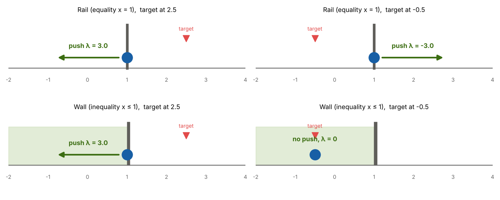

### λ as a price

λ measures how much the best attainable value changes when the constraint constant is relaxed slightly. For ridge:

```math
\lambda = -\frac{d\,\mathrm{RSS}^*(t)}{dt}
```

**Derivation.** Let β\*(t) be the solution and RSS\*(t) = RSS(β\*(t)). When the constraint is active, for every t: (i) ∇RSS = −λ∇g, and (ii) g(β\*(t)) = t.

1.  Chain rule: dRSS\*/dt = ∇RSS · dβ\*/dt.

2.  Substitute (i): dRSS\*/dt = −λ ∇g · dβ\*/dt.

3.  Differentiate (ii): ∇g · dβ\*/dt = 1.

4.  Combine: dRSS\*/dt = −λ.

**Check (1-D).** RSS = (β − 3)² with β² ≤ t gives β\* = √t and RSS\*(t) = (3 − √t)² for t \< 9.

| t   | λ = (3 − β)/β | −dRSS\*/dt = (3 − √t)/√t |
|-----|---------------|--------------------------|
| 1   | 2             | 2                        |
| 4   | 0.5           | 0.5                      |
| 9   | 0             | 0 (OLS reached)          |

In the 2x² + √5·y example, λ = 2 at the max means enlarging the circle to x² + y² = 1 + ε raises the maximum by about 2ε.

|                           | Equality                                 | Inequality                                                |
|---------------------------|------------------------------------------|-----------------------------------------------------------|
| Job 1: line up the arrows | yes                                      | yes                                                       |
| Sign of λ                 | any; only says which side f is bigger on | matters; says whether the boundary is really blocking you |
| λ = 0                     | rare                                     | answer inside, constraint ignored                         |
| Size of λ                 | price of the constraint                  | price of the constraint                                   |

## 11. Ridge regression in Lagrange terms

The ridge λ is the Lagrange multiplier of the constraint ‖β‖² ≤ t, where t is the constraint constant c.

```math
\mathcal L(\beta, \lambda) = \mathrm{RSS}(\beta) + \lambda(\beta^T\beta - t), \qquad \frac{\partial \mathcal L}{\partial \lambda} = \beta^T\beta - t
```

The term −λt has no β, so minimizing over β leaves exactly the ridge objective RSS(β) + λβᵀβ: the penalty is the λ(g − c) term with g = βᵀβ and c = t.

**The λ derivative.** Because ridge uses ≤, ∂𝓛/∂λ = βᵀβ − t is not simply set to zero. KKT requires βᵀβ − t ≤ 0, λ ≥ 0 and λ(βᵀβ − t) = 0, so ∂𝓛/∂λ = 0 holds only when the constraint is active.

**Each multiplier gives one constraint constant.** Pick λ ≥ 0, solve ∇RSS + λ∇g = 0 to get β̂\_λ, and evaluate t = g(β̂\_λ) = ‖β̂\_λ‖². Since ‖β̂\_λ‖² decreases strictly in λ, the match between λ and t is one-to-one. In practice λ is chosen directly (often by cross-validation) and t is never written down.

| λ      | Effect                                        |
|--------|-----------------------------------------------|
| 0      | no constraint, ridge = OLS                    |
| larger | smaller constraint constant t, more shrinkage |
| → ∞    | t → 0, β → 0                                  |

**Equality versus inequality for ridge.** Forcing βᵀβ = t gives the same answer as ridge when OLS is outside the disk, but a wrong (negative-λ) answer when OLS is inside.

| OLS position     | Inequality βᵀβ ≤ t (ridge) | Equality βᵀβ = t             |
|------------------|----------------------------|------------------------------|
| outside the disk | on the edge, λ \> 0        | on the edge, λ \> 0 (same)   |
| inside the disk  | OLS itself, λ = 0          | forced onto the edge, λ \< 0 |

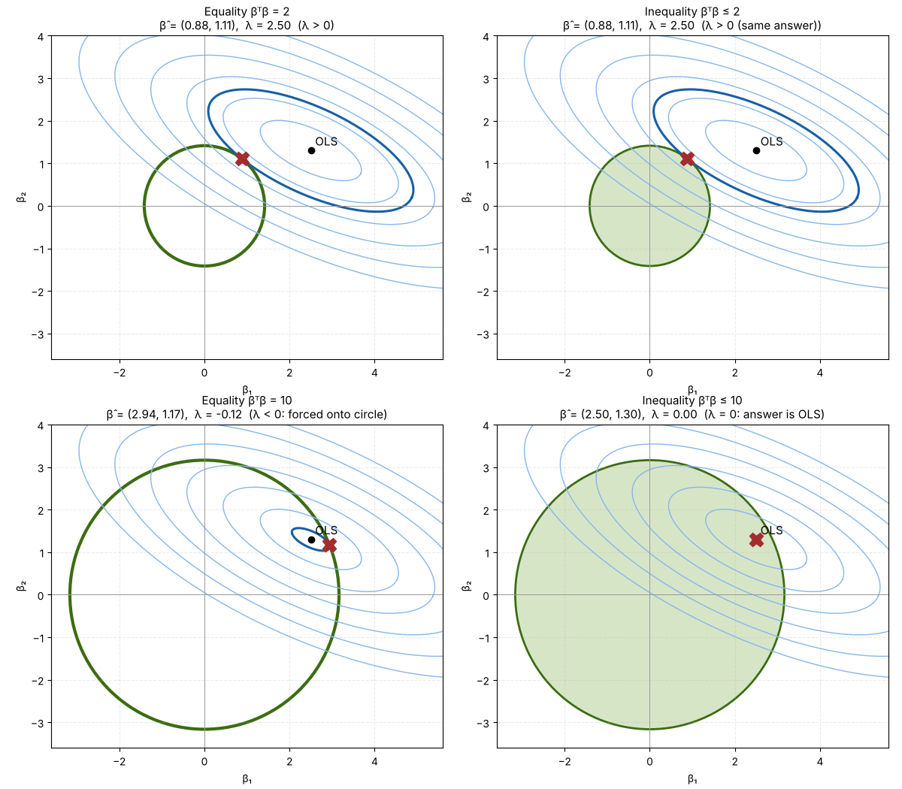

**Why λ ≥ 0 in ridge.** At an edge solution ∇g = 2β points outward. You only stop at the edge if lower RSS lies outside, so ∇RSS points inward. Inward is opposite to outward, so ∇RSS = −λ∇g with λ \> 0. A negative λ would mean RSS falls going inward, so the edge would not be the minimum. In the penalized form, λ \> 0 makes large β costly (shrinkage), while λ \< 0 would reward large β.

## 12. How c and λ are related

Increasing the constraint constant loosens the constraint: the best value improves and \|λ\| shrinks. Whether λ ever reaches 0 depends on whether f has a peak.

### For f = 2x + y on x² + y² = c

From 2 = 2λx we get λ = 1/x, and the max point is x = 2√(c/5), so

```math
f^*_{\max} = \sqrt{5c}, \qquad \lambda_{\max} = \frac{\sqrt5}{2\sqrt c} = \frac{d f^*_{\max}}{dc}, \qquad f^*_{\min} = -\sqrt{5c}, \qquad \lambda_{\min} = -\frac{\sqrt5}{2\sqrt c}
```

| c    | Max point    | Max f | λ at max | Min f | λ at min |
|------|--------------|-------|----------|-------|----------|
| 0.25 | (0.45, 0.22) | 1.12  | 2.24     | −1.12 | −2.24    |
| 1    | (0.89, 0.45) | 2.24  | 1.12     | −2.24 | −1.12    |
| 4    | (1.79, 0.89) | 4.47  | 0.56     | −4.47 | −0.56    |
| 9    | (2.68, 1.34) | 6.71  | 0.37     | −6.71 | −0.37    |

As c increases: the circle grows, the max rises and the min falls, the best points move outward along (2, 1), and both values of λ move toward 0. λ is the slope of the best-value curve, so the max keeps rising but more slowly. Because 2x + y is a plane with no peak, λ approaches 0 but never reaches it (λ = 0.11 at c = 100, 0.011 at c = 10,000).

### For ridge (1-D, RSS = (β − 3)², β² ≤ t)

λ = (3 − √t)/√t for t \< 9, then λ = 0: once the allowed interval contains OLS = 3, the constraint stops mattering and λ is exactly 0. The equality version β² = t would instead go negative.

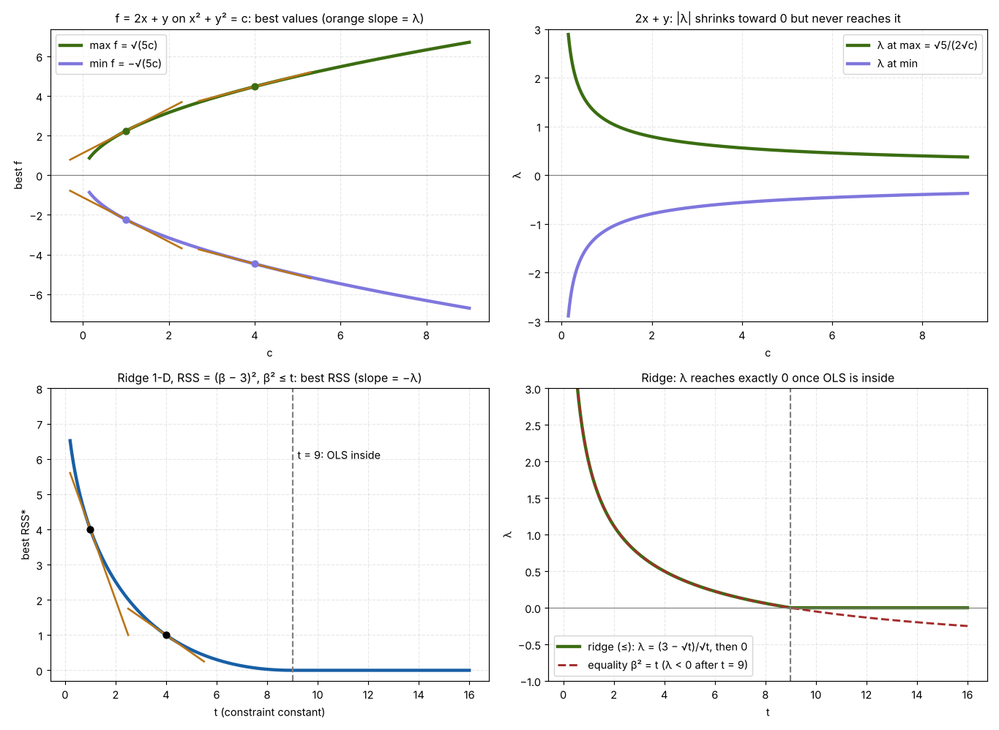

| f                        | As c (or t) grows, λ…                                   |
|--------------------------|---------------------------------------------------------|
| no peak (2x + y)         | approaches 0, never reaches it                          |
| has a peak (ridge’s RSS) | reaches exactly 0 once the peak is inside, then stays 0 |

### Who controls what

| Form                          | You choose                   | You get                        |
|-------------------------------|------------------------------|--------------------------------|
| Constrained (pure Lagrange)   | c (or t)                     | λ, the price of the constraint |
| Penalized (ridge in practice) | λ, often by cross-validation | t = ‖β̂\_λ‖² (never needed)     |

Each λ matches exactly one t, so both forms give the same solutions. Ridge controls λ because there is only one linear equation to solve, (XᵀX + λI)β = Xᵀy, and no constraint to check.

| λ     | Constraint constant t       | Regularization | β̂               |
|-------|-----------------------------|----------------|-----------------|
| large | small (tight disk)          | strong         | shrunk toward 0 |
| small | large (loose disk)          | weak           | close to OLS    |
| 0     | large enough to contain OLS | none           | OLS             |

### Getting t from λ

1.  **Solve for β with the penalty:** minimize RSS + λ‖β‖², giving β̂\_λ = (XᵀX + λI)⁻¹Xᵀy.

2.  **Put β̂\_λ into the constraint function:** t = g(β̂\_λ) = ‖β̂\_λ‖².

**Why t = g(β̂\_λ).** Constraint view: if λ \> 0, complementary slackness λ(g − t) = 0 forces g = t, so the solution sits exactly on the edge. Penalty view: starting from λ there is no t yet, so you define t = g(β̂\_λ) and check, with the direct proof, that no β inside that disk has a smaller RSS than β̂\_λ.

**1 variable** (RSS = (β − 3)²): β̂\_λ = 3/(1 + λ) and t = 9/(1 + λ)².

| λ   | β̂\_λ    | t   |
|-----|---------|-----|
| 2   | 1       | 1   |
| 0.5 | 2       | 4   |
| 0.1 | 2.73    | 7.4 |
| 0   | 3 (OLS) | 9   |

**2 variables:** XᵀX = \[\[2, 1\], \[1, 2\]\], Xᵀy = (3, 3), OLS = (1, 1). With λ = 1, solve \[\[3, 1\], \[1, 3\]\]β = (3, 3) to get β̂ = (0.75, 0.75), so t = 0.75² + 0.75² = 1.125.

| λ   | β̂\_λ         | t     |
|-----|--------------|-------|
| 0   | (1, 1), OLS  | 2     |
| 1   | (0.75, 0.75) | 1.125 |
| 3   | (0.5, 0.5)   | 0.5   |

**3 variables:** XᵀX = diag(1, 2, 4), Xᵀy = (3, 4, 4), OLS = (3, 2, 1). With a diagonal XᵀX each coefficient is β̂ⱼ = (Xᵀy)ⱼ / (dⱼ + λ).

| λ   | β̂\_λ             | t    |
|-----|------------------|------|
| 0   | (3, 2, 1), OLS   | 14   |
| 1   | (1.5, 1.33, 0.8) | 4.67 |
| 4   | (0.6, 0.67, 0.5) | 1.06 |

In every case a larger λ gives a smaller t. The coefficients do not shrink by the same factor: at λ = 1, β₁ halves while β₃ keeps 80%, because directions where XᵀX is small (less information in the data) are shrunk more.

## 13. Five more examples (Wikipedia)

Five standard examples from the Wikipedia article on Lagrange multipliers. In each plot the constraint is drawn on the floor and lifted onto the surface as a thick black curve; critical points are marked with ×.

### Example 1: x + y on the unit circle

```math
\mathcal L = x + y - \lambda(x^2 + y^2 - 1)
```

The conditions 1 − 2λx = 0 and 1 − 2λy = 0 give x = y. The constraint gives 2x² = 1, so x = ±1/√2.

| Point          | f   | Type    |
|----------------|-----|---------|
| (1/√2, 1/√2)   | √2  | maximum |
| (−1/√2, −1/√2) | −√2 | minimum |

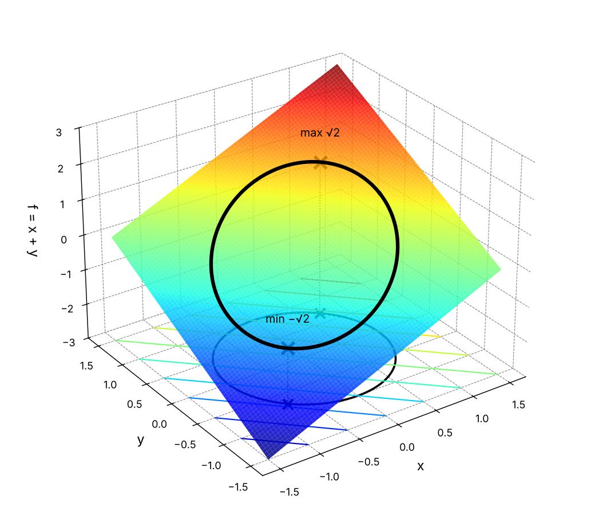

### Example 2: (x + y)² on the unit circle

```math
2(x+y)\,(1,\,1) = \lambda\,(2x,\,2y)
```

Either x + y = 0 (then λ = 0) or x = y.

| Point                        | f   | Type                           |
|------------------------------|-----|--------------------------------|
| (1/√2, 1/√2), (−1/√2, −1/√2) | 2   | maximum (tangent level curves) |
| (1/√2, −1/√2), (−1/√2, 1/√2) | 0   | minimum (λ = 0)                |

At the minima ∇f = 0, so λ = 0 and the level curve crosses the circle. This is the analogue of ridge’s Case A.

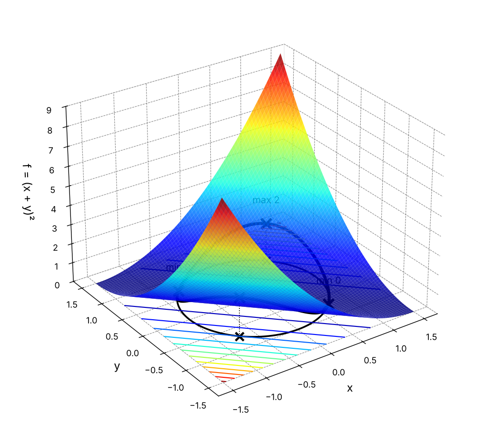

### Example 3: x²y on the circle x² + y² = 3

With 𝓛 = x²y − λ(x² + y² − 3), the conditions are 2xy = 2λx, x² = 2λy and x² + y² = 3. If x = 0, then y = ±√3 and λ = 0. Otherwise λ = y, so x² = 2y²; the constraint gives y = ±1 and x = ±√2.

| Point     | f = x²y | Type           |
|-----------|---------|----------------|
| (±√2, 1)  | 2       | global maximum |
| (±√2, −1) | −2      | global minimum |
| (0, √3)   | 0       | local minimum  |
| (0, −√3)  | 0       | local maximum  |

Each critical point is a saddle point of 𝓛 itself, not a maximum or minimum of 𝓛.

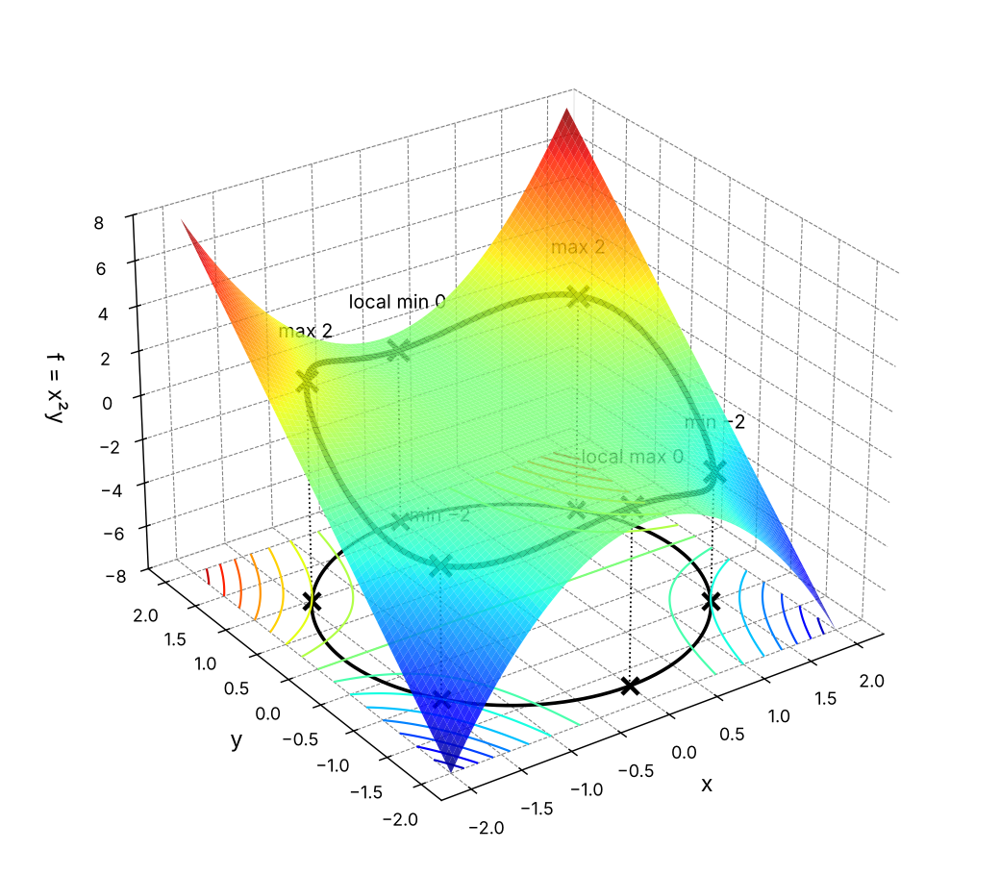

### Example 4: Maximum entropy

```math
\mathcal L = -\sum_{i=1}^n p_i \ln p_i - \lambda\Big(\sum_{i=1}^n p_i - 1\Big)
```

Setting ∂𝓛/∂pᵢ = −ln pᵢ − 1 − λ = 0 gives the same value for every pᵢ, so pᵢ = 1/n. The uniform distribution has the greatest entropy, ln n. The plot uses n = 3: the peak is ln 3 ≈ 1.099.

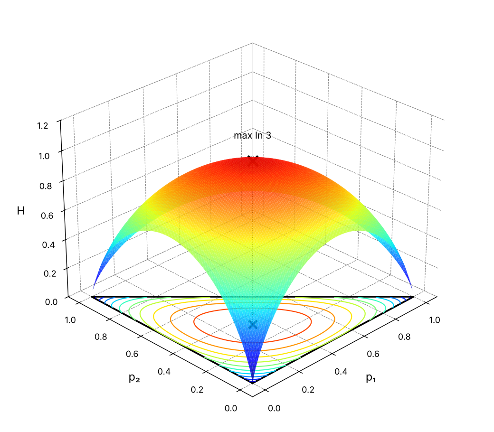

### Example 5: Numerical optimization

Minimize x² subject to x² = 1, with 𝓛 = x² + λ(x² − 1). The critical points x = ±1, λ = −1 are saddle points of 𝓛, which many numerical minimizers cannot find. Instead minimize

```math
h(x,\lambda) = |\nabla \mathcal L|^2 = (2x + 2\lambda x)^2 + (x^2 - 1)^2
```

which is ≥ 0 and equals 0 exactly at (±1, −1).

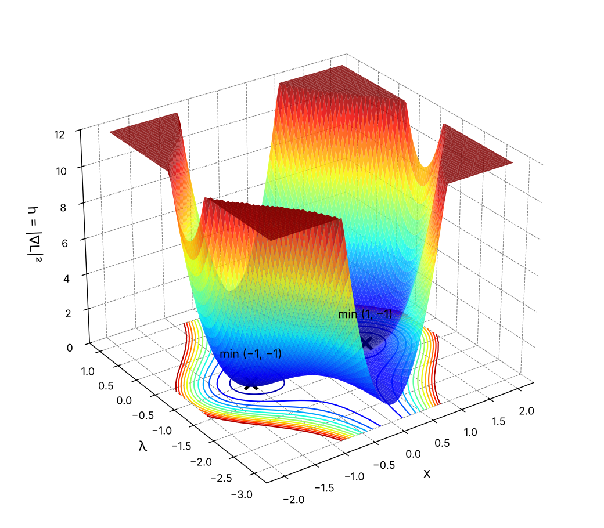

## Part II: Ridge regression as constrained minimization

This part proves that ridge regression’s penalized form and its constrained form give the same estimator, using the tools of Part I.

## 14. The two forms of ridge

The ridge estimator can be obtained by penalizing the size of the coefficients, or by minimizing the RSS under a constraint on their size.

**Penalized form (usual definition).** For a tuning parameter λ ≥ 0:

```math
\hat\beta_\lambda = \arg\min_\beta \; (\mathbf y - \mathbf X\beta)^T(\mathbf y - \mathbf X\beta) + \lambda\sum_{j=1}^p \beta_j^2 = (\mathbf X^T\mathbf X + \lambda I)^{-1}\mathbf X^T\mathbf y
```

**Constrained form.** For a constraint constant c \> 0:

```math
\min_\beta \; (\mathbf y - \mathbf X\beta)^T(\mathbf y - \mathbf X\beta) \quad \text{subject to} \quad \sum_{j=1}^p \beta_j^2 \le c
```

**Claim.** For every c there is a λ ≥ 0, and for every λ there is a c, such that the two problems have the same solution.

## 15. Step 1: The Lagrangian and the stationarity condition

Minimizing the Lagrangian over β gives exactly the ridge normal equations. Write the constraint as βᵀβ − c ≤ 0 and attach a multiplier λ ≥ 0:

```math
\mathcal L(\beta,\lambda) = (\mathbf y - \mathbf X\beta)^T(\mathbf y - \mathbf X\beta) + \lambda(\beta^T\beta - c)
```

Set the gradient with respect to β equal to zero:

```math
\frac{\partial \mathcal L}{\partial \beta} = -2\mathbf X^T(\mathbf y - \mathbf X\beta) + 2\lambda\beta = 0 \quad\Longrightarrow\quad (\mathbf X^T\mathbf X + \lambda I)\,\beta = \mathbf X^T\mathbf y
```

The term −λc does not depend on β, so it vanishes. For a fixed λ, minimizing the Lagrangian is the same as minimizing the penalized ridge objective. What remains is to find which λ belongs to a given c.

## 16. Step 2: Complementary slackness

The KKT conditions (Section 8) require:

```math
\lambda\,(\beta^T\beta - c) = 0, \qquad \lambda \ge 0, \qquad \beta^T\beta - c \le 0
```

So at the solution either λ = 0 (multiplier switched off) or βᵀβ = c (solution on the boundary). A positive λ with spare room (βᵀβ \< c) is impossible.

**λ as the price of the constraint** (Section 10):

```math
\lambda = -\frac{d\,\mathrm{RSS}^*(c)}{dc}
```

| Situation      | Constraint     | Multiplier | Solution                             |
|----------------|----------------|------------|--------------------------------------|
| ‖β̂\_OLS‖² ≤ c  | slack          | λ = 0      | ordinary least squares (Case A)      |
| ‖β̂\_OLS‖² \> c | tight: βᵀβ = c | λ \> 0     | ridge β̂\_λ with ‖β̂\_λ‖² = c (Case B) |

**Case A.** With λ = 0, Step 1 reduces to the OLS normal equations XᵀXβ = Xᵀy, valid only when OLS already satisfies the constraint.

**Case B.** If OLS lies outside the region, λ \> 0 and complementary slackness forces the solution onto the boundary:

```math
\|\hat\beta_\lambda\|^2 = c, \qquad \hat\beta_\lambda = (\mathbf X^T\mathbf X + \lambda I)^{-1}\mathbf X^T\mathbf y
```

## 17. Step 3: One-to-one correspondence between c and λ

Each constraint constant c in (0, ‖β̂\_OLS‖²) matches exactly one λ \> 0. With the SVD X = UDVᵀ (singular values dⱼ, left singular vectors uⱼ):

```math
\|\hat\beta_\lambda\|^2 = \sum_{j} \frac{d_j^2\,(u_j^T\mathbf y)^2}{(d_j^2+\lambda)^2}
```

Each term decreases strictly in λ, so ‖β̂\_λ‖² runs continuously and strictly downward from ‖β̂\_OLS‖² at λ = 0 to 0 as λ → ∞. By the intermediate value theorem, ‖β̂\_λ‖² = c has exactly one solution λ.

**Sufficiency.** RSS is convex and the constraint set is convex, so the KKT conditions are sufficient as well as necessary: the ridge estimator is the global constrained minimizer.

## 18. A direct proof without Lagrange multipliers

Fix λ ≥ 0 and set c = ‖β̂\_λ‖². Because β̂\_λ minimizes the penalized objective, every β satisfies

```math
\mathrm{RSS}(\beta) + \lambda\|\beta\|^2 \;\ge\; \mathrm{RSS}(\hat\beta_\lambda) + \lambda c
```

For any β with ‖β‖² ≤ c, rearranging gives

```math
\mathrm{RSS}(\beta) \;\ge\; \mathrm{RSS}(\hat\beta_\lambda) + \lambda\big(c - \|\beta\|^2\big) \;\ge\; \mathrm{RSS}(\hat\beta_\lambda)
```

since λ ≥ 0 and c − ‖β‖² ≥ 0. So β̂\_λ has the smallest RSS among all feasible β. ∎

## 19. Worked example in one dimension

### 19.1 Constructing the data

With one predictor and no intercept, completing the square gives

```math
\mathrm{RSS}(\beta) = \Big(\sum x_i^2\Big)\big(\beta - \hat\beta_{OLS}\big)^2 + \mathrm{RSS}_{\min}, \qquad \hat\beta_{OLS} = \frac{\sum x_i y_i}{\sum x_i^2}
```

Choose x values with Σxᵢ² = 1 and set yᵢ = 3xᵢ, so the points lie exactly on y = 3x:

| i   | xᵢ  | yᵢ = 3xᵢ |
|-----|-----|----------|
| 1   | 0.6 | 1.8      |
| 2   | 0.8 | 2.4      |

Then Σxᵢ² = 1, Σxᵢyᵢ = 3 and Σyᵢ² = 9, so β̂\_OLS = 3 and RSS(β) = 9 − 6β + β² = (β − 3)². The ridge estimator minimizes (β − 3)² + λβ², giving

```math
\hat\beta_\lambda = \frac{3}{1+\lambda}
```

### 19.2 The constraint as an interval

Taking square roots and using √(β²) = \|β\|:

```math
\beta^2 \le c \;\Longleftrightarrow\; |\beta| \le \sqrt c \;\Longleftrightarrow\; -\sqrt c \le \beta \le \sqrt c
```

For c = 4, the values 3 and −2.5 are excluded while −2, −1.5, 0, 1 and 2 are allowed. In p dimensions the constraint is a ball of radius √c.

### 19.3 The two cases

| c   | Allowed interval        | Answer       | λ   | Complementary slackness |
|-----|-------------------------|--------------|-----|-------------------------|
| 16  | \[−4, 4\], contains OLS | β = 3        | 0   | 0 × (9 − 16) = 0        |
| 4   | \[−2, 2\], excludes OLS | β = 2 (edge) | 0.5 | 0.5 × (4 − 4) = 0       |

Stationarity check at c = 4: 2(2 − 3) + 2(0.5)(2) = 0.

**Why λ \> 0 with spare room fails.** If λ = 2 were proposed for c = 4, it gives β = 1 with RSS = 4, but β = 2 is also feasible with RSS = 1. Over-shrinking inside the region can always be improved by moving toward OLS.

**Price check.** For c \< 9, RSS\*(c) = (3 − √c)² and dRSS\*/dc = −(3 − √c)/√c, which is −0.5 at c = 4, matching λ = 0.5.

## 20. Geometric interpretation and the lasso

The ridge estimate is the point where the smallest RSS contour (an ellipse centred at β̂\_OLS) first touches the disk of radius √c.

- **OLS inside the disk (Case A):** the solution is OLS and λ = 0.

- **OLS outside the disk (Case B):** the solution is the tangency point, where ∇RSS = −λ∇‖β‖² with λ \> 0.

**Lasso.** The lasso uses Σ\|βⱼ\| ≤ c, a diamond with corners on the axes. Contours often first touch a corner, setting some coefficients exactly to zero. The smooth ridge disk has no corners, so ridge shrinks coefficients but rarely makes them exactly zero.

## 21. The ridge picture in 3D

The figure uses an illustrative RSS with minimum 2 at β̂\_OLS = (2.5, 1.3), tilted ellipses from correlated predictors, and constraint constant c = 1.

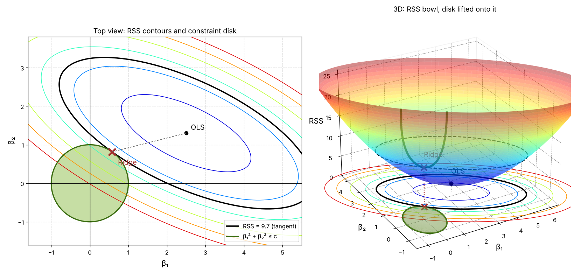

- OLS lies outside the disk (Case B).

- The first ellipse to touch the disk has RSS ≈ 9.7; the ridge estimate is (0.58, 0.81) with λ ≈ 5.09.

- At that point ∇RSS = −λ∇‖β‖²: the same tangency as Section 2, with an ellipse in place of a line.

- In 3D, the ridge estimate is the lowest point of the circle lifted onto the bowl.

- The ridge estimate is not on the straight line from OLS to the origin; shrinkage follows the shape of the ellipses.

## 22. The penalized objective: how λ changes the shape

```math
J(\beta) = \underbrace{(\mathbf y - \mathbf X\beta)^T(\mathbf y - \mathbf X\beta)}_{\text{RSS: tilted bowl centred at OLS}} + \underbrace{\lambda\,\beta^T\beta}_{\text{penalty: round bowl centred at 0}}
```

Completing the square shows the sum is again a bowl:

```math
J(\beta) = (\beta - \hat\beta_\lambda)^T(\mathbf X^T\mathbf X + \lambda I)(\beta - \hat\beta_\lambda) + \text{const}
```

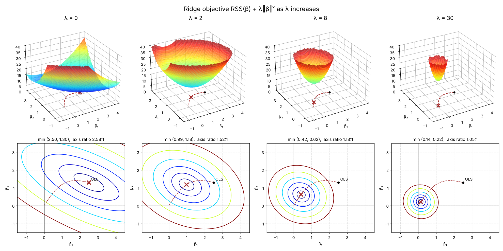

| λ   | Minimum β̂\_λ       | Ellipse axis ratio |
|-----|--------------------|--------------------|
| 0   | (2.50, 1.30) = OLS | 2.58 : 1           |
| 2   | (0.99, 1.18)       | 1.52 : 1           |
| 8   | (0.42, 0.62)       | 1.18 : 1           |
| 30  | (0.14, 0.22)       | 1.05 : 1           |

As λ increases:

1.  **The bottom moves** from OLS toward the origin along the ridge path, a curve shaped by the tilted ellipses.

2.  **The ellipses become rounder:** the eigenvalues μ₁, μ₂ of XᵀX become μ₁ + λ, μ₂ + λ, so their ratio approaches 1.

3.  **The bowl becomes steeper:** every curvature grows by λ, so XᵀX + λI is always invertible and the solution is unique.

Each λ gives a minimum whose squared length ‖β̂\_λ‖² is the constraint constant c (Section 12). Increasing λ is the same as shrinking the disk in Section 21.

## 23. Summary recipe

To maximize or minimize f subject to g(x, y) = c:

1.  **Build the Lagrangian:** write the constraint as g − c = 0, then 𝓛 = f − λ(g − c).

2.  **Set ∇𝓛 = 0:** this gives ∇f = λ∇g (from x and y) and g = c (from λ). Equivalently, write those two conditions directly.

3.  **Solve** for x, y and λ; split into cases when an equation factors (for example x = 0 or λ = 2).

4.  **Evaluate f** at every solution, and at any boundary points of the allowed region. The largest is the max, the smallest the min.

5.  **For an inequality g ≤ c** (as in ridge), add complementary slackness: either λ = 0 with the unconstrained optimum inside, or λ \> 0 with the solution on g = c.

Key ideas to remember:

- Max and min occur where a contour of f is tangent to g = c; a crossing contour always leaves room to go higher and lower.

- Tangent contours mean parallel gradients: ∇f = λ∇g.

- c never appears in ∇f = λ∇g; it enters only through g = c.

- λ is unknown in advance and can differ at each critical point; it measures the price of the constraint.

For inequality constraints and the sign of λ:

- λ \> 0: ∇f points the same way as ∇g, so f is bigger outside; λ \< 0: f is bigger inside.

- Equality: any sign of λ is valid (a rail pushes both ways).

- Inequality: the sign must match the goal (λ ≥ 0 for a max with ∇f = λ∇g, and for ridge’s + convention); a wall can only push.

- λ = 0 means the answer is inside and the constraint is slack; ridge then returns OLS.

- λ is the price of the constraint: λ = −dRSS\*/dt.

### Sources

- [Lagrange multipliers, introduction – Khan Academy](https://www.khanacademy.org/math/multivariable-calculus/applications-of-multivariable-derivatives/constrained-optimization/a/lagrange-multipliers-single-constraint)

- [Lagrange multiplier – Wikipedia](https://en.wikipedia.org/wiki/Lagrange_multiplier)
